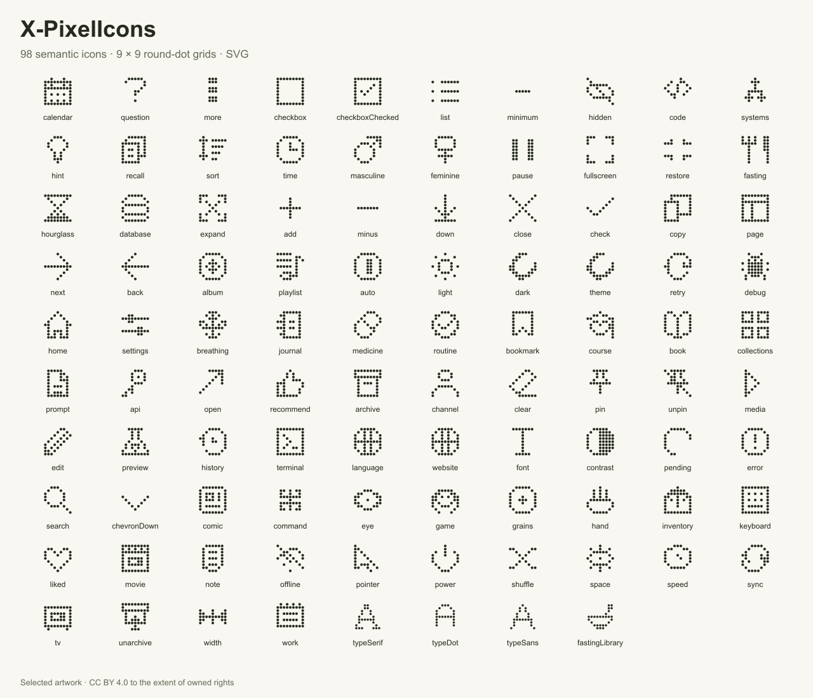

# X-PixelIcons artwork

[English](README.md) · [简体中文](README.zh-CN.md) · [繁體中文](README.zh-TW.md)
· [日本語](README.ja.md) · [한국어](README.ko.md) · [Español](README.es.md)

98点の選定済みSVG素材です。安定したIDと由来／出力ハッシュを持つカタログを添付します。

## 使う

`icons/<id>.svg` を直接使用し、`editable grids.json` も同梱します。catalog.json
に安定IDと元／出力ハッシュがあり、使用にサーバー・アカウント・ビルドツールは不要です。
SVG の currentColor はインラインで CSS 色を継承し、img
では周囲の文字色を継承しません。編集グリッドと元のキャンバス寸法を保持します。

## ライセンスと出典

X-PixelIconsと同梱の出典を表示し、https://creativecommons.org/licenses/by/4.0/
へリンクして変更を明記してください。CC BY4.0
は所有者が許諾できる権利だけを対象とし、商標や第三者の権利を与えません。自作の丸点グリッドから生成し、学習参考から画像やコードを輸入していません。

文書用マーク：codingEzio、[CC BY 4.0](https://creativecommons.org/licenses/by/4.0/)
([ARTWORK-LICENSE.md](ARTWORK-LICENSE.md))。変更を明記してください。この独立した許諾は
`docs/icon.svg` だけを対象とし、選定済みコレクションの作品範囲は変更しません。

## ソース範囲

このローカルソース候補には、選定済み98個のアイコンと再構築可能なソースツリーが含まれます。Git履歴は元の非公開リポジトリから独立しています。私有オリジナルと未選定のブランド関連アイコン2個は含みません。出典・メタデータ・可視内容の審査は限定的で、包括的な権利保証ではありません。LICENSE-SCOPE.json
と public-files.json を参照してください。
